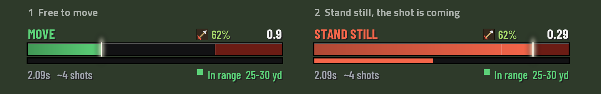
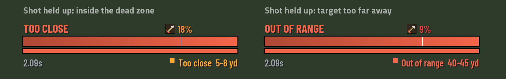
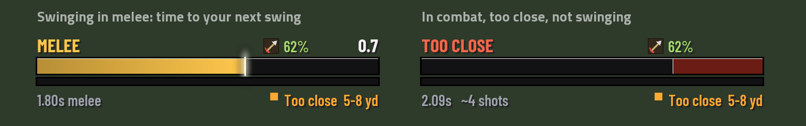
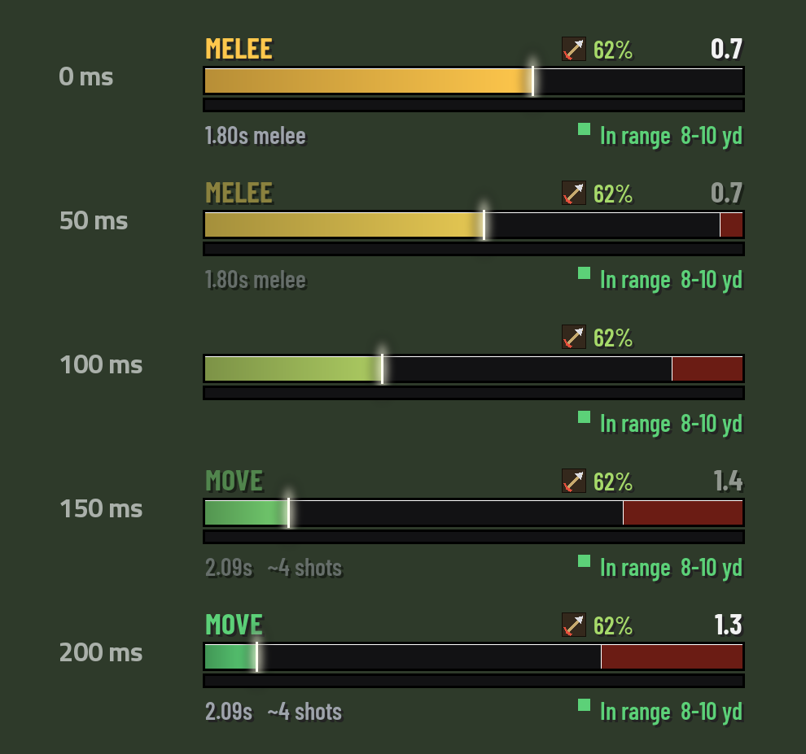
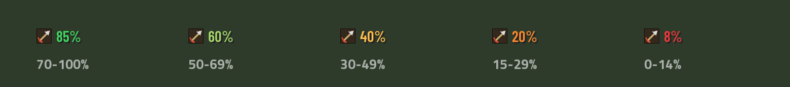
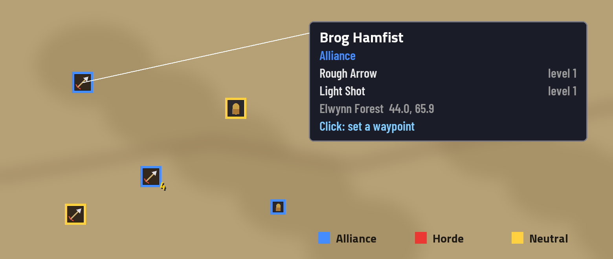
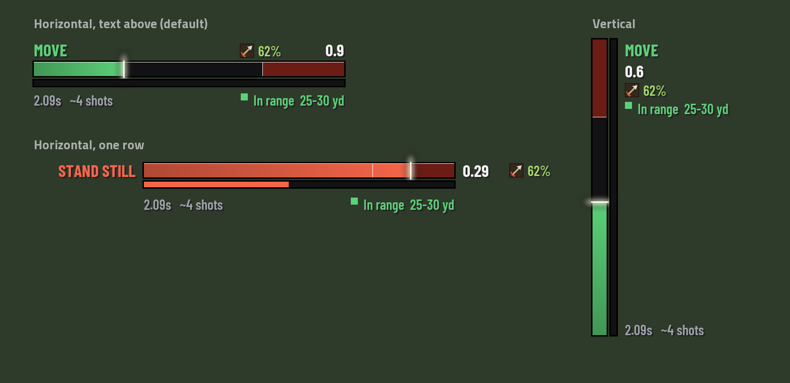
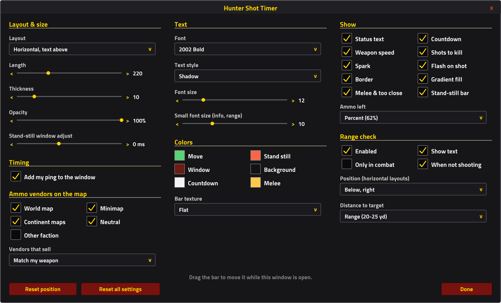
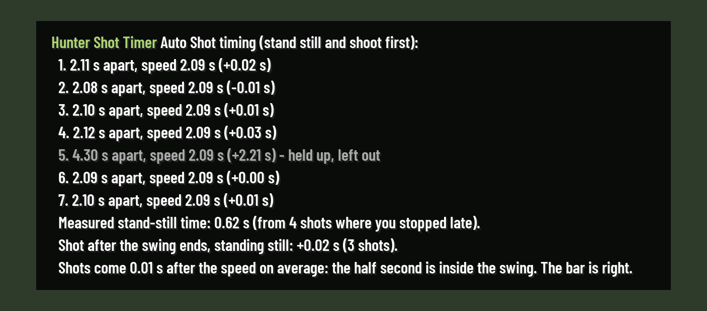

# Hunter Shot Timer

**An Auto Shot bar for hunters on WoW Forever.** It shows when you are free to move and when
you must stand still so your next Auto Shot fires on time. It also has a small range check
with the distance to your target, an estimate of shots to kill, ammo left, and every arrow
and bullet vendor on your world map and minimap.



> The images on this page are previews drawn from the addon's own layout code at the default
> settings (`tools/render_previews.py`). In game the text uses the client's 2002 Bold font
> and the ammo slot shows your real arrow or bullet icon.

- [Download and install](#download-and-install)
- [How Auto Shot works](#how-auto-shot-works-and-what-the-bar-shows)
- [Features](#features)
- [Settings](#settings-hst)
- [Commands](#commands)
- [Troubleshooting](#troubleshooting)

---

## Download and install

1. **Download** `HunterShotTimer.zip` from the
   [latest release](https://github.com/Fkleppe/HunterShotTimer/releases/latest).
2. **Close WoW.**
3. **Unzip** it into the Forever client's AddOns folder, so you end up with:

   ```
   World of Warcraft\_classic_beta_\Interface\AddOns\HunterShotTimer\HunterShotTimer.toc
   ```

   The folder must be called exactly `HunterShotTimer` and the `.toc` file must sit directly
   inside it (not in a second folder below it).
4. **Start WoW.** On the character screen, open **AddOns** and make sure
   **Hunter Shot Timer** is ticked.
5. Log in on your hunter and type **`/hst`** to open the settings.

<details>
<summary>Installing from the source code instead (Code → Download ZIP, or git)</summary>

GitHub's **Code → Download ZIP** unpacks as `HunterShotTimer-main`. Rename that folder to
`HunterShotTimer` before putting it in `Interface\AddOns`. With git, clone straight into the
AddOns folder:

```
cd "C:\Program Files (x86)\World of Warcraft\_classic_beta_\Interface\AddOns"
git clone https://github.com/Fkleppe/HunterShotTimer.git
```

Update later with `git pull` in that folder. The extra `docs`, `tests` and `tools` folders are
for development; the game ignores them.
</details>

**Updating:** replace the folder with the new version. Your settings are kept: they live in
`WTF\Account\<account>\SavedVariables\HunterShotTimer.lua`, not in the addon folder.
Restart WoW when an update adds or removes files; otherwise `/reload` is enough.

**Requirements:** the WoW Forever client (`_classic_beta_`, interface 16001). The bar only
appears for hunters. No other addons are needed.

---

## How Auto Shot works, and what the bar shows

Auto Shot fires once per weapon swing. You can run around during most of the swing, but the
game only lets the shot go after you have **stood still for about half a second**. If you are
still moving when the swing ends, the shot waits until you stop, and you lose that time.

The bar is one swing long:

| Part of the bar | Meaning |
|---|---|
| **Green, "MOVE"** | Free to move. The countdown on the right shows how long you have left. |
| **Red window at the end** | Stand still here. It is the engine's half second, plus your ping (your "I stopped" has to reach the server). |
| **Red, "STAND STILL"** | The shot is coming: do not move. The countdown shows how long until it fires. |
| **Red, "STOP"** | You are moving where you must stand still. The shot waits until you stop. |
| **Slim bar underneath** | The stand-still bar: it fills over exactly the time you must stand still and is full as the arrow or bullet leaves. |
| **Spark** | Where you are in the swing. It pulses while a shot is overdue. |
| **Flash** | A short flash across the bar when the shot fires. |

**It sees when you stand still.** The bar reads from the game whether you are moving (a jump
counts too), so you never have to guess. Moving in the red window says **STOP**. Once you
stand still, the countdown is the real time to the shot: the end of the swing, or a full
half second (plus ping) after you stopped if you stopped late. Without that, the shot would
seem to come "late" for no reason.

**The stand-still bar shows exactly how long to stand still.** It starts the moment you
have to stand still, or the moment you stop if you stop late, and it is full as the shot
goes. While you stand, the countdown runs in hundredths (`0.29`). If you move, it empties
and says STOP. The time is not a guess: the addon measures it on your own shots (from the
moment you stopped to the moment the arrow left), so your ping and the server's timing are
in it. Until it has three such shots it uses the half second plus your ping. `/hst timing`
shows what it measured. Switch the bar off with **Stand-still bar** in the settings.

When a swing is over but no shot has gone off, the bar stays full and tells you why:



- **TOO CLOSE**: the target is inside the minimum range (the dead zone, under 8 yd). Step back.
- **OUT OF RANGE**: the target is too far away for Auto Shot. Get closer.
- **STOP** / **STAND STILL** (while late): you moved. Stand still, and the countdown shows when
  it fires.

**Your real speed, haste included.** The bar is driven by the game's own swing event, which
reports the actual time to the next shot. Quiver or ammo pouch haste, Rapid Fire, Quick
Shots, Berserking and other haste are all included. A haste buff that starts in the middle of
a swing takes effect from the next shot, exactly as the game does it. The number under the bar
(`2.09s`) is that real speed, so with a quiver it is lower than the speed on your bow.

---

## Features

### Melee range: the bar stays

When you are too close for Auto Shot, the bar does not disappear:



- **MELEE** (gold): while you auto-attack in melee, the bar times your main-hand swings,
  with the countdown to the next one. Handy for Raptor Strike, which goes off with your next
  swing. There is no stand-still window: melee does not need you to stand still.
- **TOO CLOSE**: in combat, too close for Auto Shot and not swinging. Back off to 8 yards
  or more, or start meleeing. Melee mode starts once you actually swing at a target in
  melee range; switching attack on at range does not turn the bar into MELEE.

Going between ranged and melee is never a hard cut. Over a fifth of a second the fill
glides to its new place, the colour and the stand-still window follow, and the texts fade
out and back in with the new words. Right at the edge of melee range the bar waits until
"too close" has held for a moment, so it does not flicker back and forth.



Switch it off with **Melee & too close** in the settings; the melee colour is under Colors.

### Range check and distance

A coloured dot and text under the bar: **In range**, **Too close** or **Out of range**, for a
hostile target. Next to it the distance to the target, either as a 5 yard bracket
(`25-30 yd`) or as a single estimate (`~28 yd`), your choice. WoW does not give addons an
exact distance; the bracket comes from asking the game which item ranges reach the target.

### Shots to kill

`~4 shots` under the bar: the target's health divided by your average Auto Shot (from your
character sheet; armour and crits are left out, so it is an estimate). It only appears when
the game lets addons read the target's health. Type `/hst probe` during a fight to see what
your client allows.

### Ammo left

A small arrow or bullet icon with how much ammo you have left, as a percentage of what your
quiver or ammo pouch holds (or of your last restock if you have none), or as a count. The
colour tells you at a glance when to restock:



### Ammo vendors on the world map and minimap

Every NPC that sells arrows or bullets: **117 vendors** in Classic, checked against Wowhead's
"Sold by" lists. Pins are coloured by faction: **blue** Alliance, **red** Horde, **yellow**
neutral towns (Booty Bay, Gadgetzan, Ratchet, Everlook, Light's Hope, Cenarion Hold...).



- By default you see **your own side and neutral vendors** that sell the ammo your weapon
  uses (arrows for a bow or crossbow, bullets for a gun). Equip a different weapon and the
  map updates.
- **Hover** a pin for the vendor's name, faction and what they sell, with the level needed.
- **Click** a pin for a waypoint. Vendors close together share one pin with a number;
  click a city pin on a zone map to open the city map.
- City vendors show as small pins on the zone around the city, and zone vendors as small
  pins on Kalimdor and the Eastern Kingdoms.
- On the **minimap** the same vendors appear when you are near them. They are hidden in
  combat, when the game may lock your position.

### Layouts

Three layouts, all fully adjustable in size, font and colour. Every text has its own fixed
place, so nothing overlaps, whatever size you choose.



---

## Settings (`/hst`)

Everything is set in one window. While it is open the bar plays a demo and can be dragged
anywhere on screen; closing the window locks it again. You can also open it from
**Options → AddOns → Hunter Shot Timer**.



| Section | Settings |
|---|---|
| **Layout & size** | Layout (text above / one row / vertical), length, thickness, opacity, stand-still window adjust (if your shots get clipped or you stand too long) |
| **Timing** | Add your ping to the stand-still window (on by default) |
| **Ammo vendors on the map** | World map, minimap, continent maps, neutral vendors, other faction, which vendors (match my weapon / arrows and bullets / arrows only / bullets only) |
| **Text** | 16 fonts (2002 Bold by default), shadow or outline, font size, small font size |
| **Colors** | Move, stand still, window, background, countdown, melee |
| **Show** | Status text, countdown, weapon speed, shots to kill, spark, flash, border, gradient fill, melee & too close, ammo left (off / percent / count) |
| **Range check** | On/off, text, only in combat, also when not shooting, position, distance format |

**Reset position** puts the bar back in its default place, just below the middle of the screen; **Reset all settings**
restores every default but keeps the bar where it is.

---

## Commands

| Command | What it does |
|---|---|
| `/hst` | Open or close the settings (the bar can be dragged while they are open) |
| `/hst lock` / `/hst unlock` | Lock the bar, or unlock it to drag it |
| `/hst reset` | Move the bar back to its default place |
| `/hst range` | Print what the range check reads, for a target in front of you |
| `/hst probe` | Print what the shots-to-kill estimate can read (run it mid-fight) |
| `/hst timing` | After 6 Auto Shots standing still: how far apart they came, next to your speed |

`/hst timing` checks the 0.5 s stand-still that the 16 Oct beta build gave Auto Shot. If the
shots come at your ranged speed, the half second is inside the swing and the red window is
right. If they come about half a second later, it is added on top, and the bar needs a change.
Gaps where the shot was held up (you moved, or were out of range) are left out:



---

## Troubleshooting

| Problem | What to do |
|---|---|
| The addon is not in the AddOns list | Check the path: `Interface\AddOns\HunterShotTimer\HunterShotTimer.toc`. A folder called `HunterShotTimer-main`, or a folder inside a folder, does not load. Restart WoW after adding it. |
| No bar | The bar is for hunters, and appears when you start Auto Shot. Type `/hst` to see it in demo mode. |
| No range text | It shows for hostile targets only. Type `/hst range` with a target and share the output in an issue. |
| No "shots" number | Your client hides enemy health from addons. `/hst probe` mid-fight tells you. |
| Shots still get delayed | Raise **Stand-still window adjust** a little (for example +50 ms). |
| No vendor pins on the minimap | They hide in combat, and only show vendors within the minimap's range. |
| A vendor is missing or in the wrong place | Open an [issue](https://github.com/Fkleppe/HunterShotTimer/issues) with the NPC name and zone. The data is Classic's; Forever may have changed something. |

---

## For developers

- `python -I tests/test_timer.py` runs the addon in Lua 5.1 against a WoW mock (needs
  `pip install lupa`): timing, layouts with an overlap sweep, range, ammo, vendors, map and
  minimap pins, settings and commands.
- `python -I tests/bench.py` measures the bar's per-frame cost (bytes allocated, widget calls).
- `python -I tools/render_previews.py` redraws the images on this page (needs Pillow).
- `tools/build_vendors.py` rebuilds `VendorData.lua` from Wowhead's "Sold by" lists
  (`tools/wowhead_sold.json`, fetched by `tools/wowhead_sold.py`) with coordinates and
  factions from the pfQuest database, cross-checked against cMaNGOS.

## Credits

- Vendor data: Wowhead Classic, [pfQuest](https://github.com/shagu/pfQuest) (MIT) and
  [cMaNGOS classic-db](https://github.com/cmangos/classic-db); see `Media/VENDOR-DATA.txt`.
- Range item IDs from LibRangeCheck-3.0 (MIT).
- Bundled fonts are under the SIL Open Font License; see `Media/Fonts/LICENSES.txt`.
